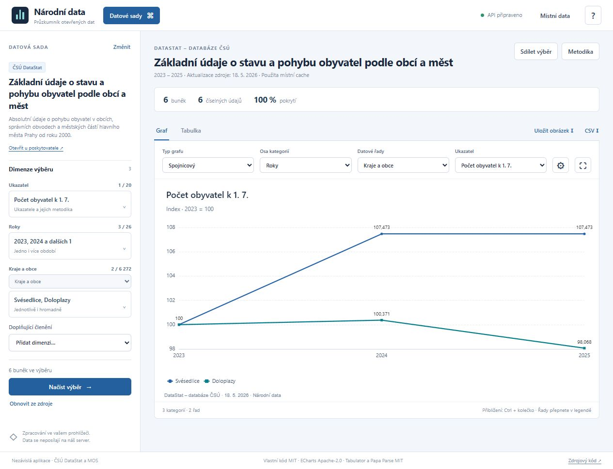

# Národní data

Nezávislý průzkumník národních otevřených dat. Procházejte datové sady ČSÚ,
vybírejte ukazatele a dimenze, porovnávejte výsledky v grafech a tabulkách.
Veškeré zpracování probíhá ve vašem prohlížeči.

[Web](https://martinrotter.github.io/csustats/) · [Návod](documentation/usage.md) ·
[Vývoj](documentation/development.md) · [Zdroje a interpretace](documentation/data.md)



## Zdroje a možnosti

- **ČSÚ DataStat:** katalog sad, automaticky sestavené filtry podle metadat,
  varianty územního členění a vlastní datové výběry přes veřejné API.
- **ČSÚ MOS:** obecní statistiky od roku 2000; výběr více obcí, okresů a krajů,
  více let a ukazatelů. Existující roční cache původního CsuStats zůstává použitelná.
- **Vlastní soubory:** CSV/TSV, JSON-stat 1.x/2.0 a ploché JSON záznamy.
  Tabulkové soubory mají průvodce přiřazením sloupců; nikam se neodesílají.
- **Grafy:** spojnicové, sloupcové, pruhové, plošné, skládané a tepelné mapy;
  volba osy a řad, výřez dalších dimenzí, legenda, zoom a indexování.
- **Export:** PNG ve vysokém rozlišení, vektorové SVG a CSV s kódy, jednotkami,
  stavy údajů a zdrojem. Obrázky obsahují název, výřez i zdroj.
- **Responzivní rozhraní:** kompaktní ovládání pro PC, tablet a telefon.
- **Srovnání a souhrny:** přepočtená hodnota vedle původní v tabulce i CSV,
  součty přes zvolenou dimenzi s pokrytím, detekce odlehlých hodnot a jejich výběr
  do grafu. Ruční výběr řad funguje nad celým načteným výběrem.
- **Čeština a angličtina:** přepínač celého UI, grafů a exportů; DataStat vrací
  metadata ve zvoleném jazyce přes `Accept-Language`. Jazyk se ukládá a sdílí v odkazu.
  Vlastní soubory a CSV zdroje zachovávají původní názvy dat.
- **Ochrana API:** společná fronta, cache, omezení frekvence, sledování HTTP
  odpovědí, respektování `Retry-After`, omezená opakování a rušení požadavků.

Projekt vznikl jako CsuStats pro MOS. Název repozitáře a adresa webu zůstávají
zachované. Nejde o oficiální aplikaci ČSÚ. Přímé procházení celého katalogu
data.gov.cz není součástí této verze; aplikace je připravená pro další zdrojové moduly.

## Samostatný HTML soubor

Výsledkem buildu je **jediný `docs/index.html`**. Obsahuje JavaScript, styly,
knihovny, pracovní vlákno i licenční texty. Nepotřebuje aplikační server, registraci
ani CDN. Lze ho hostovat na GitHub Pages nebo otevřít z disku. Síťové zdroje
vyžadují internet a dostupné CORS rozhraní poskytovatele.

Na některých lokálních či soukromých originách nemusí prohlížeč povolit IndexedDB,
Web Locks nebo schránku. Aplikace používá náhradní paměť a omezení v rámci stránky;
v takovém případě upozorní na omezení ukládání.

## Commit a push

Každý push do `master` spustí [GitHub Actions](.github/workflows/ci.yml): instalaci
připnutých závislostí, formátování, testy, kontrolu vendor souborů, sestavení
a automatické nasazení na GitHub Pages. Pull requesty se pouze kontrolují.

Jednorázové nastavení: **Settings → Pages → Source → GitHub Actions**.
Generované `docs/` se necommituje.

## Vývoj

Node.js 22 nebo novější:

```sh
npm ci
npm run check
npm run preview
```

```sh
npm test                # deterministické testy bez volání veřejného API
npm run build           # samostatné HTML do docs/
npm run format          # formátování vlastních zdrojů
npm run vendor:check    # kontrolní součty knihoven a licencí
```

```text
src/app/        životní cyklus aplikace, výběr a sdílení stavu
src/core/       datová kostka, projekce grafů, HTTP fronta a rate limiting
src/data/       DataStat, obecná CSV čtečka, datové profily, cache a worker
src/i18n/       čeština, anglický slovník a lokalizace rozhraní
src/ui/         katalog, dimenze, grafy, tabulky, import a export
src/styles/     responzivní vzhled
scripts/        build, lokální náhled a kontrola knihoven
test/           datové, HTTP, workerové a buildové testy
vendor/         připnuté knihovny, zdrojové URL, SHA-256 a licence
documentation/  návod, architektura a datová omezení
docs/           generovaný výstup; ignorovaný v Gitu
```

## Licence

Vlastní kód [MIT](LICENSE), © 2026 Martin Rotter. Použité knihovny jsou bezplatné:
ECharts (Apache-2.0), Tabulator a Papa Parse (MIT). Jejich licence a další oznámení
jsou v [THIRD_PARTY_NOTICES.md](THIRD_PARTY_NOTICES.md) i ve výsledném HTML.
Licence aplikace nemění podmínky zdrojových dat.
