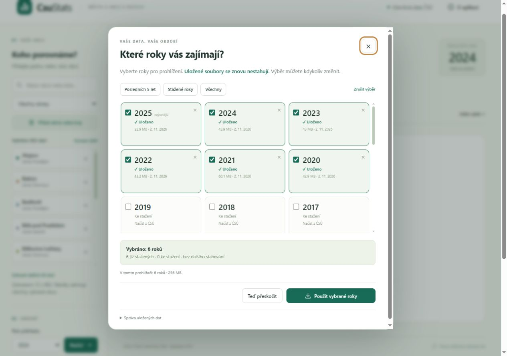

# Použití CsuStats

## Roky a obce

Při otevření vyberte požadované roky. Zeleně označené soubory už jsou v prohlížeči
a nepřenášejí se znovu. Průběhový dialog ukazuje čekání, stahování, zpracování,
uložené soubory a celkový průběh. Načítání lze zrušit; hotové roky zůstávají uložené.
Dialog lze znovu otevřít přes **Spravovat stažené roky**.

Obec hledejte názvem, i bez diakritiky, nebo šestimístným kódem. Okres pomáhá
rozlišit stejné názvy. Přes **Přidat okres nebo kraj** vyberete několik celků
najednou. Lze připojit jejich obce bez duplicit nebo celý výběr nahradit.
Územní příslušnost odpovídá zvolenému roku podle MOS.

U velkých výběrů je v levém panelu nejprve 12 obcí; další lze rozbalit. Přehled
i exporty vždy zahrnují celý výběr. Stejně pojmenované obce rozlišuje okres.

## Přehled, porovnání a historie

**Přehled roku** dovoluje hledat název, kód nebo okruh ukazatele a řadit sloupce.
Kliknutím na řádek se otevře porovnání a metodika. Souhrnné karty popisují první
vybranou obec. Další sloupce jsou dostupné posunutím široké tabulky.

**Porovnání obcí** ukazuje vybraný ukazatel v grafu i tabulce. Vhodné početní a
peněžní ukazatele lze přepočítat na 1 000 obyvatel k 31. 12. stejného roku.
U velkého výběru graf zobrazuje posuvný výřez; tabulka zůstává úplná.

**Vývoj v čase** vyžaduje načtení celého zvoleného období. Uložené CSV se použije
z cache. Index nastaví první společný rok s dostupnou nenulovou hodnotou všech
vybraných obcí na 100. Při více než 20 obcích graf standardně kreslí prvních 10;
ovladač **Obce v grafu** dovoluje 20, 50 nebo všechny. Tabulka a CSV obsahují všechny.

## Dostupnost a export

- `0` je skutečná nula a počítá se jako dostupný číselný údaj.
- `—` znamená nedostupný údaj; `i.d.` označuje chráněný údaj.
- Ukazatele bez číselných hodnot pro vybrané obce jsou standardně skryté; lze je
  zobrazit přepínačem. Vybraný ukazatel zůstane dostupný pro metodiku.
- **⚠ málo dat** označuje pokrytí menší než polovina požadovaných kombinací
  obec/rok nebo jediný dostupný údaj z více požadovaných. V historii také jediný
  dostupný rok z více zvolených let.
- Nenačtené roky nejsou považované za prokazatelně chybějící data. Ukazatele se
  definitivně filtrují až po načtení období.

Tlačítko **CSV** exportuje tabulku; přehled respektuje vyfiltrované řádky. CSV je
UTF-8 s BOM a oddělovačem `;`. Ikona u grafu vytvoří PNG s titulkem, obdobím a
zdrojem. **Sdílet výběr** kopíruje adresu obsahující nastavení za znakem `#`.

## Otevření z disku a cache

Samostatné `docs/index.html` funguje v aktuálním Firefoxu, Chromu nebo Edge bez
aplikačního serveru. Internet je potřeba pro první stažení dat. Trvalé úložiště
u `file://` závisí na prohlížeči; pokud není dostupné či je plné, aplikace oznámí
přechod na omezenou dočasnou paměť. Uložené roky spravujete ve výběru roků.

Cache je oddělená podle prohlížeče a adresy webu; při přechodu z disku na hosting
se nepřenáší. Příjemce odkazu na soubor z disku potřebuje vlastní HTML a část
adresy od `#`. Pro sdílení je pohodlnější veřejná webová adresa.
